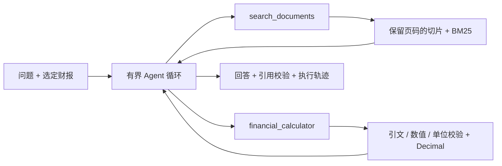

# 研迹 · 财报研究 Agent

面向 **AI / Agent 开发工程师求职作品集**的本地 MVP：上传财报、提出研究问题，检索原文、调用财务计算工具，再生成带引用的研究简报。提供中文界面、工具执行轨迹、计算依据展开、原文跳转和 Markdown 导出。

内置「启衡科技 2024 年报」为**虚构数据**，不代表任何真实上市公司。

## 快速运行

需要 Python 3.12。使用当前 `/workspace/helllo` 检出目录即可；每个云任务已有隔离环境，无需另建 Git worktree。

```bash
cd /workspace/helllo
python -m pip install -r requirements.txt
python -m uvicorn app.main:app --host 127.0.0.1 --port 8000
```

应用监听本机 8000 端口。健康检查：`curl --fail http://127.0.0.1:8000/api/health`。API 文档路径：`/docs`。没有前端构建步骤，不依赖外部字体或 CDN。

无需密钥即可体验离线流程：

1. 保持选中虚构年报，点击「经营质量分析」，再点击「开始研究」。
2. 核查收入同比 25.00%、归母净利率 14.40%、经营现金流 / 归母净利润 122.22% 等结果。
3. 展开计算依据，点击引用回到原文，查看右侧实际工具调用记录。
4. 试问「能否根据这份财报预测明年股价」，检查证据不足行为。
5. 导入自己的 PDF / UTF-8 TXT / Markdown；离线模式只返回检索原文预览。

**离线演示不是大模型 Agent**：虚构年报运行固定的检索与计算流程；上传文档只进行抽取式检索。真实工具决策需要下方模型配置。界面和导出文件均保留模式标识。

## 接入真实模型

使用支持 Chat Completions `tools` / `tool_calls` 的 OpenAI 兼容服务。在环境的安全变量设置中提供以下变量，重启服务：

| 变量 | 用途 | 默认值 |
| --- | --- | --- |
| `LLM_API_KEY` | 模型服务密钥 | 无；未配置时禁用真实模式 |
| `LLM_BASE_URL` | HTTPS API 基址 | `https://api.openai.com/v1` |
| `LLM_MODEL` | 支持工具调用的模型 | `gpt-4.1-mini` |

受限网络需要放行模型 API 域名；保持平台代理和 TLS 校验。代理注入的凭证须绑定到相同域名。不要把密钥写进仓库或发到聊天中。`.env.example` 只说明变量，程序不自动加载 `.env`。

真实模式会向模型服务发送问题、文档元数据和检索片段；工具只访问本次选定的文档。模型根据工具结果继续决策，直到回答或触发上限。未配置密钥时不会自动伪装成真实模式。

## 架构与取舍



- **检索**：中文二元切词和英文词项 BM25，不需要向量服务，便于复现与调试。PDF 保留实际页码；TXT / MD 是一个逻辑文本段。固定长度切片可能截断长表格，这是当前限制。
- **工具计算**：支持同比、比率和差值。只接受已检索来源中的逐字引文和原文数值；单位不一致、零分母、负数增长基期均明确报错。使用 `Decimal` 并保留公式、输入和来源。
- **Agent 编排**：自实现短循环以展示消息协议、工具注册、参数校验和错误恢复。最多 8 轮、12 次工具调用、180 秒总执行时间；瞬态模型错误最多尝试 2 次。模型调用失败显示错误，不偷偷降级成离线答案。
- **引用校验**：检查引用 ID 是否真实存在，未通过标记待核查；这不等同于语义蕴含校验。科目、期间、币种与合并口径仍可能被模型误读，需结合引文人工审核。
- **文档边界**：文档作为不可信数据进入工具结果；不提供 Shell、交易或任意网络工具。提示词约束并不能完全消除提示注入。
- **存储**：单用户本地进程内存，最多 10 份上传资料，重启不保留。PDF 最大 5 MB / 120 页、文本最多 30 万字符；无 OCR，不支持扫描件与加密 PDF。

当前尚未实现账户体系、多用户资料隔离、持久化、实时行情和生产部署。不要将本机 MVP 直接作为公共多用户服务。

## 测试与评测

```bash
cd /workspace/helllo
python -m unittest discover -s tests -v
python scripts/evaluate.py --output .local/evaluation.json
```

测试覆盖源文档检索、十进制计算、伪造数值/引文/来源拒绝、单位检查、除零、负基期、缺证据、文本和真实 PDF 上传、上传限制、引用校验、模拟模型的检索→计算→回答循环、上游失败和轮次上限。

若开发环境已安装 Playwright 和 Chromium，可在服务运行时执行 `python scripts/browser_smoke.py`，验证桌面/手机布局、财务结果、引用跳转、导出文件内容和文档导入。可用 `--browser` 指定 Chromium 可执行文件；截图保存在忽略提交的 `.local/` 目录。

`scripts/evaluate.py` 包含 6 个离线回归案例，非真实模型准确率评测；失败会返回非零退出码。模型工具循环使用 MockTransport 测试协议，不能据此声称真实模型服务已经验证。接入模型后应补充带人工标注的真实财报数据集，分别测量检索召回、科目/期间正确率、计算正确率、引用支持率、拒答与成本。

## 面试中可以讲什么

1. 为什么用有界工具循环，而不是仅将整个 PDF 放进一次聊天请求。
2. 如何把模型负责的「选择科目、期间与工具」和程序负责的「计算与格式校验」分开。
3. 为什么引用存在不代表结论正确，如何设计后续语义校验和人工评测。
4. BM25 的可复现优势，以及复杂表格、跨期问答、语义召回下需要升级的部分。
5. 通过真实失败案例说明调用上限、重试、证据不足与数据口径校验的意义。

项目可作为简历里的可演示起点；接入真实模型、补充真实财报评测后，再填写有依据的效果数据，不把离线模板的通过率当作模型表现。

## 目录

```text
app/documents.py     文档、分页切片、BM25、虚构示例
app/finance.py       财务计算与证据校验
app/agent.py         工具注册、真实模型循环、离线演示
app/main.py          FastAPI、上传、研究 API
web/                无构建步骤的中文界面
tests/              自动化测试
scripts/evaluate.py 离线回归评测
```
